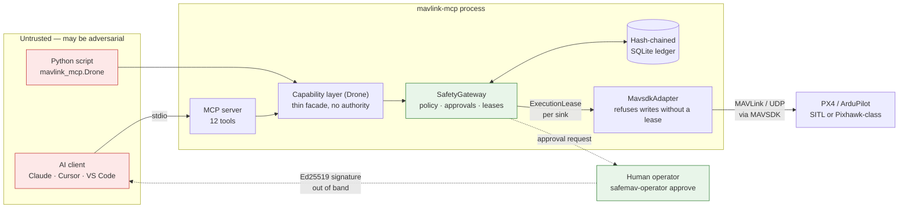

# mavlink-mcp

[](LICENSE)
[](https://www.python.org/)

**mavlink-mcp** is a **vendor-neutral UAV capability layer + [Model Context Protocol](https://modelcontextprotocol.io) server built on open standards**. It connects AI agents (Claude Desktop, Cursor, VS Code, and any other MCP client) to drones that speak **MAVLink** — PX4 SITL, ArduPilot SITL, and Pixhawk-class autopilots — through [MAVSDK](https://mavsdk.mavlink.io/) (BSD-3-Clause). Instead of wrapping protocol messages, it exposes **8 flight capabilities** (telemetry, flight mode, arm/disarm, takeoff, land, goto, mission, return-to-launch) behind one clean API with safety guardrails on by default.

It is the sister project of [rosbridge-mcp](https://github.com/hieutachi/rosbridge-mcp) (AI agents ↔ ROS 2 robots) and shares its philosophy: open protocols only, readonly-by-default guardrails, simulation-first, zero telemetry, MIT licensed.

> **Note on the name:** "mavlink-mcp" is a provisional working name. "MAVLink" is a trademark of the Dronecode Foundation; the project name may be adjusted pending a review of their trademark policy before any public release.

> **Safety disclaimer:** this project is built for **simulation and research**. Flying real aircraft with it is entirely at your own risk and responsibility, including compliance with your local aviation law (registration, flight permits, pilot licensing). See [SECURITY.md](SECURITY.md).

## Measured against its own previous guardrails

Two real code arms, the same scenarios, the same recording adapter. 2,340
trials, Wilson 95% intervals, raw data in [`benchmark/results/`](benchmark/results/).
An action counts as *prevented* only if no physical sink was invoked and the
simulated vehicle did not change state — a refusal message after the command
was already sent is a failure. No language model participates in any decision.

| | Original guardrails (`962448c`) | SafeMAV gateway (`7055a49`) |
| --- | --- | --- |
| Unauthorized execution | 82.6% [79.6–85.3] | **4.3%** [3.1–6.1] |
| Unauthorized takeoff | 66.7% [59.5–73.1] | **0%** [0–2.1] |
| Approval replay accepted | 100% | **0%** |
| Parameter tampering accepted | 100% | **0%** |
| Degraded-telemetry execution | 100% | **0%** |
| Policy bypass | 100% | **14.3%** |
| **False rejection, legitimate ops** | **0%** | **0%** |
| Authorization latency (median) | 0.002 ms | 18.2 ms |

The last two rows matter as much as the first. Zero false rejection means the
attack numbers were not bought by refusing work — a deny-everything
configuration, measured as a control arm, scores 100% false rejection and
*still* lets 13% of unauthorized calls through. The residual 4.3% and 14.3% are
one known gap, published rather than hidden: in-process Python that reads the
gateway's private issuer object can forge a lease. It fails on both arms, it
has [a test that asserts it](tests/safety/test_bypass_attempts.py), and closing
it needs OS-level isolation this project does not implement.

Full method, per-subcase verdicts and what could not be measured:
[BENCHMARK_RESULTS.md](docs/BENCHMARK_RESULTS.md).

## Why a capability layer, not another SDK?

- **For AI agents, capabilities beat 400 SDK functions.** An agent asks `get_capabilities` ("what can this drone do?"), gets back a small vocabulary of physical actions, and plans with it — no MAVLink knowledge needed on the model side.
- **Vendor-neutral by construction.** Capabilities are defined in physical quantities (degrees, meters, volts) from open specs — not copied from any proprietary SDK surface. The MAVSDK adapter is one implementation; a future ROS 2 adapter (reusing rosbridge-mcp) implements the same interface.
- **Authorization is part of the API, not an afterthought.** Readonly is the default. Every command that can move the vehicle needs an Ed25519 approval signed by a separate operator key, bound to that exact request, and re-checked immediately before each physical write. Altitude, geofence, battery and vehicle-state limits are enforced in the same path.

## Architecture



Telemetry reads flow back the same way without needing approval. Python scripts
use the identical capability layer, so there is no privileged side door: a
`Drone` built without a gateway cannot write at all.

The **safety gateway** owns all authorization — signed approvals, replay protection, telemetry freshness, altitude and geofence limits, and the audit ledger. The **capability layer** (`Drone`) is a thin facade over it. The **adapter** (`MavsdkAdapter`) only translates approved operations to MAVLink and refuses any write without a valid execution lease; it is the only module that imports `mavsdk`. New backends implement the same `DroneAdapter` interface and inherit both surfaces (MCP tools + Python library) and every guardrail for free.

### What a takeoff actually costs the agent

`takeoff` touches two MAVSDK sinks, so authority is verified twice — once per
physical write, with no `await` between the check and the call.

```mermaid
sequenceDiagram
    participant A as AI agent
    participant G as SafetyGateway
    participant H as Human operator
    participant D as MAVSDK adapter
    participant V as Autopilot

    A->>G: takeoff(altitude=20)
    G->>G: admission — policy, state, telemetry freshness
    G-->>A: REQUIRE_APPROVAL + request_id, nonce, digest
    Note over A,H: the agent cannot sign; the key is never in this process
    A->>H: shows the exact request
    H->>H: reviews altitude, vehicle, expiry
    H-->>A: Ed25519 token bound to this request only
    A->>G: takeoff(20, request_id, approval_token)
    G->>G: verify signature, nonce unspent, parameters byte-identical
    G->>D: lease(sink 1 of 2)
    D->>V: set_takeoff_altitude(20000 mm)
    G->>G: re-check deadline, epochs, policy hash, operator key, ledger
    G->>D: lease(sink 2 of 2)
    D->>V: takeoff()
    G-->>A: ACKNOWLEDGED — accepted by the autopilot, not "landed safely"
```

If anything changes between sink 1 and sink 2 — the approval expires, telemetry
goes stale, home or the connection epoch shifts, the policy file changes, the
operator key loses scope, the ledger becomes unwritable — the second sink does
not run and the request is recorded `UNKNOWN`, which latches the writer closed
across process restarts. Replaying the token afterwards returns
`APPROVAL_REPLAY` with zero sinks.

## Quick Start

### Read-only in one command

```bash
git clone https://github.com/hieutachi/mavlink-mcp.git
cd mavlink-mcp && git checkout safemav/p08-p09-gateway
python -m venv .venv
source .venv/bin/activate        # Windows PowerShell: .venv\Scripts\Activate.ps1
pip install -e ".[dev]"
```

Add to your MCP client config (Claude Desktop, Cursor, VS Code, ...):

```json
{
  "mcpServers": {
    "mavlink": {
      "command": "mavlink-mcp",
      "env": { "MAVLINK_MCP_BACKEND": "sim" }
    }
  }
}
```

Then ask your agent: *"What can this drone do, and where is it right now?"*
Telemetry works immediately. Every tool that could move the vehicle answers
`READONLY` — because no trusted launch config was supplied, and that is the
default.

### A vehicle you can actually fly, with no autopilot

The bundled simulator is a network-free kinematic model over a real MCP stdio
server. Generate an operator key, write a launch config (see
[Configuration](#configuration)), and start the server with
`SAFEMAV_CONFIG=./safemav.json MAVLINK_MCP_BACKEND=sim`. All 12 tools then work
against a moving synthetic vehicle without Docker, ROS or PX4. Telemetry is
labelled synthetic; battery and GPS are null. This is a kinematic integration
test, **not** a physics or energy simulator.

The fastest end-to-end demonstration — eight approved actions and three
refusals over real MCP stdio, with a throwaway key — is one script:

```bash
python examples/patrol_sim.py
```

### Against a real autopilot

Start PX4 SITL ([one Docker command](docs/simulator-quickstart.md), or headless
with [tools/run_sitl.sh](tools/run_sitl.sh)), point the server at it with
`MAVLINK_MCP_BACKEND=mavsdk` and `MAVLINK_MCP_URL=udpin://0.0.0.0:14540`, and
keep `SAFEMAV_CONFIG` set. `docs/SITL_EVIDENCE.md` records what that looks like
when it works and what each refusal returns.

> **`MAVLINK_MCP_READONLY=false` does not grant write access.** It is a legacy
> guardrail flag, not an authorization switch. Without a valid `SAFEMAV_CONFIG`
> there is no gateway to approve against, so writes stay refused. Pointing a
> real aircraft at this without reading [Limitations](#limitations) and
> [SECURITY.md](SECURITY.md) is not a supported use.

## Capabilities & tools

12 tools covering 8 capabilities. Every tool returns JSON and none raises for a policy refusal: a denied call comes back as `decision: DENY` with `error` and `guardrail: true` set, so the agent can read the reason code and react. See [What the agent sees](#what-the-agent-sees).

| Tool | Capability | What it does | Mutating? |
| --- | --- | --- | --- |
| `get_capabilities` | — | What the vehicle supports + active guardrails | no |
| `get_telemetry` | Telemetry | Position, attitude, battery, GPS, mode, armed, in-air | no |
| `get_flight_mode` | FlightMode | Current flight mode (HOLD, MISSION, RTL, ...) | no |
| `get_connection_status` | — | Endpoint, connection state, guardrail config | no |
| `arm` | Arm/Disarm | Spin up motors | **signed approval** |
| `disarm` | Arm/Disarm | Stop motors (on the ground) | **signed approval** |
| `takeoff` | Takeoff | Climb to a target altitude | **signed approval** + altitude limit |
| `land` | Land | Land at the current position | **signed approval** |
| `hold` | FlightMode | Pause: stop and loiter in place | **signed approval** |
| `return_to_launch` | ReturnToLaunch | Fly home and land | **signed approval** |
| `goto_location` | Goto | Fly to one waypoint and loiter | **signed approval** + geofence/altitude |
| `fly_mission` | Mission | Upload a waypoint mission and start it | **signed approval**, every waypoint checked |

## What the agent sees

Every tool returns JSON. A write is never executed on the first call: it returns
an approval request, and the agent has to resubmit the same call with the signed
token. That shape is the contract — the agent can plan, but cannot proceed
without a signature it is unable to produce.

First call, no approval yet (`arm` on a healthy vehicle). Trimmed for width,
nothing removed but the surrounding fields:

```json
{
  "schema_version": 1,
  "request_id": "37b647e6-0add-46fd-963e-60b3ea4dc6a6",
  "decision": "REQUIRE_APPROVAL",
  "reason_code": "APPROVAL_REQUIRED",
  "execution_status": "NOT_STARTED",
  "partial_effects": false,
  "approval_request": {
    "action": "arm",
    "actor_id": "demo-agent",
    "vehicle_id": "demo-vehicle",
    "gateway_id": "demo-gateway",
    "environment": "kinematic",
    "parameters": {},
    "reference_frame": "HOME_RELATIVE",
    "request_digest": "b92296b2…7ab093",
    "policy_hash": "0b3f1583…401a83e3",
    "boot_epoch": "gMMOEXdkj1s01rLk239WuzD7",
    "connection_epoch": "1",
    "home_epoch": "1",
    "home_anchor": {"latitude_e7": 473977420, "longitude_e7": 85455940,
                    "absolute_altitude_amsl_mm": 488000, "vertical_datum": "AMSL"},
    "mission_digest": null,
    "nonce": "laI6gT73j1ukzEN_sioGA00L8z8WwND5RTM3SBBD234",
    "issued_at_utc_ms": 1794847050162,
    "expires_at_utc_ms": 1794847110162
  }
}
```

That payload is the whole security argument in one object: the digest covers the
action and the canonical parameters, and the surrounding fields pin the decision
to one actor, one vehicle, one gateway instance, one policy file, one connection,
one home position and one 60-second window. Change any of them and the signature
no longer matches what is being executed.


Resubmitted after a human signed it, with one parameter changed:

```json
{
  "schema_version": 1,
  "request_id": "r-91c2",
  "decision": "DENY",
  "reason_code": "PARAMETER_MISMATCH",
  "execution_status": "NOT_STARTED",
  "partial_effects": false,
  "error": "PARAMETER_MISMATCH",
  "guardrail": true
}
```

Only `DENY` sets `error`, so needing consent is not reported as a fault — an
agent should treat `REQUIRE_APPROVAL` as the normal next step. `partial_effects`
is `true` when a multi-sink action stopped between its calls; in that case
`execution_status` is `UNKNOWN` and the writer latches closed.

Reason codes an agent can branch on:

| Reason code | Meaning |
| --- | --- |
| `APPROVAL_REQUIRED` | A signature is needed; nothing was sent. |
| `APPROVAL_INVALID` | Signature wrong, token unbound, or key not trusted. |
| `APPROVAL_EXPIRED` | The signed window closed. |
| `APPROVAL_REPLAY` | This approval was already spent (including a concurrent duplicate). |
| `PARAMETER_MISMATCH` | Something a human signed is not what is being executed. |
| `VEHICLE_CHANGED` / `POLICY_CHANGED` | Identity, connection epoch, home anchor or policy hash moved since approval. |
| `TELEMETRY_STALE` / `TELEMETRY_INCOMPLETE` | Receipts too old, or a required field never arrived. |
| `UNSAFE_STATE` | The vehicle is not in a state where this action is legal (e.g. `goto` while grounded). |
| `OUTSIDE_GEOFENCE` / `ALTITUDE_LIMIT` | Envelope refusal. |
| `INVALID_ARGUMENT` | Not representable — `NaN`, sub-millimetre altitude, unknown field. |
| `READONLY` / `GATEWAY_UNAVAILABLE` | No trusted launch config, or no gateway composed. |
| `EXECUTION_UNKNOWN` | A previous action is in an uncertain state; the writer is latched. |
| `BUSY` | Another command holds the writer. |

## Example conversation

> **You:** Check the drone and, if it's healthy, do a short patrol at 20 m.
>
> **Agent:** *(calls `get_capabilities` — sees readonly is off, geofence 200 m; calls `get_telemetry` — GPS `FIX_3D`, 10 satellites, battery 100%)*
> The drone is healthy. I need your approval to arm and take off — confirm?
>
> **You:** Confirmed, go ahead.
>
> **Agent:** *(calls `arm` — gets back an approval request, not an action)*
> Request `a1b2c3` is waiting for your signature.
>
> **You:** *(runs `safemav-operator review request.json` to read the exact numbers, then
> `safemav-operator approve request.json --key operator.key --key-id demo-key --operator-id alice --output approval.token`
> — signing is a local, interactive step)*
>
> **Agent:** *(resubmits `arm` with the signed token, then `takeoff(altitude_m=20)` the same way, then `fly_mission` with 3 waypoints inside the geofence, monitors `get_telemetry`, finishes with `return_to_launch`)*
> Patrol complete — the drone is back at the launch point and disarmed.

## Configuration

Two layers, deliberately separate. **Environment variables** configure how the
process runs. **The launch config** carries every safety-relevant decision, and
policy limits live only there — so whatever launched the process cannot widen
them.

| Variable | Default | Effect |
| --- | --- | --- |
| `SAFEMAV_CONFIG` | unset | Path to the trusted launch config. **Unset means read-only, no gateway.** |
| `MAVLINK_MCP_BACKEND` | `mavsdk` | `sim` (kinematic) or `mavsdk` (real adapter). Unknown values fail closed; there is no fallback. |
| `MAVLINK_MCP_URL` | `udpin://0.0.0.0:14540` | MAVLink endpoint for the `mavsdk` backend. |
| `MAVLINK_MCP_READONLY` | `true` | Legacy flag. Can refuse, **cannot** authorize. |
| `SAFEMAV_RUNTIME_DIR` | platform default | Where the ledger lives when `ledger_path` is relative. |

### The trusted launch config

Create the operator keypair first. The private half never goes near the server:

```bash
safemav-operator keygen --output operator.key --key-id demo-key --operator-id alice
```

It prints the public half and writes 32 private bytes to `operator.key`. Store
that file where the server cannot read it, ideally on another machine. Then
`safemav.json`, holding only the public key:

```json
{
  "actor_id": "demo-agent",
  "vehicle_id": "demo-vehicle",
  "gateway_id": "demo-gateway",
  "environment": "kinematic",
  "readonly": false,
  "bootstrap": true,
  "ledger_path": "ledger.sqlite3",
  "policy": {
    "readonly": false,
    "max_altitude_m": 50,
    "max_radius_m": 200,
    "min_battery_percent": 30
  },
  "trust_keys": [{
    "key_id": "demo-key",
    "operator_id": "alice",
    "roles": ["human_operator"],
    "vehicles": ["demo-vehicle"],
    "actions": ["arm", "disarm", "takeoff", "land", "hold",
                "return_to_launch", "goto", "fly_mission"],
    "public_key": "2NsfkoDPStiE7yRIUx1iKHi7RO0cgzi55kk19nVxpug"
  }]
}
```

`bootstrap: true` creates the ledger on first run; after that, remove it or set
it to `false`. An invalid, unreadable or mismatched config raises and refuses to
start — it never falls back to defaults or to a mock environment. Two
independent denial switches (`readonly` at the top level and inside `policy`)
must both permit writes.

### Policy keys

| Key | Default | Meaning |
| --- | --- | --- |
| `max_altitude_m` | 50 | Ceiling above the launch point. |
| `max_radius_m` | 200 | Soft fence radius around home. |
| `max_speed_mm_s` | 5000 | Per-waypoint speed ceiling. |
| `min_battery_percent` | 30 | Refuse new flights below this. |
| `max_age_ms` | 1000 | Oldest acceptable telemetry receipt. |
| `max_skew_ms` | 500 | Oldest acceptable spread across fields. Measured PX4 needs ≥ 2000; see [SITL_EVIDENCE](docs/SITL_EVIDENCE.md). |
| `min_satellites` | 10 | GPS quality gate for arming in the `px4_sitl` profile. |
| `numerical_margin_mm` | 50 | Slack added before comparing against a limit. |

Defaults are tuned for the mock and kinematic tiers. They are a starting point
for a simulator, not validated thresholds for any aircraft — measured PX4
telemetry already forced one correction.

## Safety

Letting a language model command an aircraft is a real risk, so the guardrails are stricter than a typical SDK:

1. **Readonly by default, and no gateway means no writes.** Without a trusted
   `SAFEMAV_CONFIG` launch file the server exposes telemetry only. Setting
   `MAVLINK_MCP_READONLY=false` does not grant write access on its own.
2. **Signed human approval, not a boolean.** An agent's first call returns an
   approval request. A human signs that exact request with an Ed25519 key the
   server only knows the public half of (`safemav-operator approve`), and the
   agent resubmits it unchanged. `confirm=true` is deprecated and authorizes
   nothing. The approval is bound to the actor, vehicle, gateway, boot epoch,
   policy hash, connection epoch, home position and exact parameters, and is
   single-use.
3. **Re-checked at every physical write.** Commands like takeoff touch two
   MAVSDK sinks. Before each one the gateway re-verifies the approval deadline
   (UTC and monotonic), telemetry freshness, home and connection epochs, the
   policy hash, the operator key, and that the audit ledger is still writable.
   If anything changed between the first sink and the second, the second does
   not run and the request is recorded `UNKNOWN`.
4. **Deterministic limits.** Altitude ceiling, geofence radius, speed, battery
   reserve, GPS fix quality and vehicle state are checked on canonical integer
   units, with float32 rounding accounted for, before anything is sent.
5. **Durable audit.** Every request, approval, sink check and outcome is in a
   hash-chained SQLite ledger. An uncertain outcome latches the writer closed,
   across process restarts.
6. **`ACKNOWLEDGED` is not "done".** It means the autopilot accepted the
   command. Observe telemetry before concluding a flight finished.

Evidence for these claims, measured against a live headless PX4 SITL, is in
[docs/SITL_EVIDENCE.md](docs/SITL_EVIDENCE.md).

**Scope limit, stated plainly:** enforcement covers the MCP tools and the
supported Python API in this process. It is not an OS sandbox. Code already
running inside the same interpreter can read the gateway's private issuer
object and forge a lease; that attempt is enumerated and tested in
[docs/THREAT_MODEL.md](docs/THREAT_MODEL.md) section 8b and summarised in [Limitations](#limitations). These checks are also
**not** a substitute for the autopilot's own failsafes, a real geofence
configured in PX4/ArduPilot, network isolation, or a human with an RC transmitter. Read [SECURITY.md](SECURITY.md) before considering real hardware, and treat real-world flights as requiring registration/permits under your local aviation law (e.g. Vietnam's UAV Decree 288/2025 requires registration and flight permits).

## Python library

The same capability layer is importable for scripts and notebooks. Reads need
nothing special; writes go through the same gateway as the MCP tools, so a
bare `Drone` is read-only by design:

```python
from mavlink_mcp import Drone
from mavlink_mcp.adapters.mavsdk_adapter import MavsdkAdapter

drone = Drone(MavsdkAdapter())            # no gateway
snapshot = await drone.get_telemetry()    # reads are fine

result = await drone.arm()                # DENY / READONLY, nothing was sent
assert result.decision.value == "DENY" and result.reason_code.value == "READONLY"
```

To actually fly, compose the trusted runtime (ledger, policy, operator trust
store) and resubmit the signed token:

```python
from mavlink_mcp.safety.runtime import create_drone   # reads SAFEMAV_CONFIG

drone = create_drone()
pending = await drone.takeoff(20.0)
# ... operator signs pending.approval_request out of band ...
result = await drone.takeoff(20.0, request_id=pending.request_id,
                             approval_token=token)
assert result.execution_status == "ACKNOWLEDGED"   # accepted, not completed
```

Without `SAFEMAV_CONFIG`, `create_drone()` returns a read-only drone with no
gateway rather than raising — writes then refuse with `READONLY`. With a config
that is present but invalid, unreadable, or mismatched to the backend, it raises
and refuses to start. A complete runnable version — ephemeral operator key, the
approval loop, and the refusal cases — is
[examples/patrol_sim.py](examples/patrol_sim.py).

## Limitations

Written first, not last. Where a limitation can be demonstrated, it is
asserted by a test that expects it to fail or reproducible from committed
data; where it is a property of what was built (no aircraft was flown, a
signature is key possession) it is stated and left as such.

| Limitation (six groups; thirteen sections in the full document) | What it means |
| --- | --- |
| **Not an OS sandbox (G1/G2)** | Enforcement holds through the MCP tools and the supported Python API. It does not hold against code already running in the same interpreter: that code can read the gateway's private issuer object and forge a lease. Measured 30/30 on *both* arms, and [a test asserts it](tests/safety/test_bypass_attempts.py). Closing it needs process isolation, which is designed for and not built. |
| **No physical aircraft** | SITL exercises the MAVLink and MAVSDK path, not airworthiness, radio links or sensor failure. ArduPilot is untested. `ACKNOWLEDGED` is autopilot acceptance, never a completed flight. |
| **A signature is key possession, not judgement** | Approval fatigue, a coerced operator, and a stolen private key are not addressed. Key custody is the operator's responsibility. |
| **Freshness is arrival time, not authenticity** | A spoofed GPS produces timely, well-formed, wrong telemetry. Staleness detection is not integrity. |
| **Mocks, one host, our scenarios** | The 2,340-trial benchmark runs on deterministic mocks: it shows pre-dispatch gating, binding, fault timing and the state machine, and nothing about flight dynamics. Thirty trials of a deterministic check is one mechanism observed thirty times. Latency is one Windows host with the ledger on a cloud-synced directory. |
| **Audit is tamper-evident, not tamper-proof** | The hash chain detects edits made without the key material. It does not stop someone who can rewrite the whole file. |

Each one is developed further, with the test or data that pins it, in
[submission/KNOWN_LIMITATIONS.md](submission/KNOWN_LIMITATIONS.md) and
[docs/SECURITY_ANALYSIS.md](docs/SECURITY_ANALYSIS.md).

## Documentation

| Document | What it covers |
| --- | --- |
| [INSTALLATION.md](docs/INSTALLATION.md) | Tiered setup: tests, kinematic demo, PX4 SITL |
| [simulator-quickstart.md](docs/simulator-quickstart.md) | The three simulator options, including the no-Docker kinematic one |
| [DEMO_GUIDE.md](docs/DEMO_GUIDE.md) | Three scenarios with real transcripts |
| [SECURITY_ANALYSIS.md](docs/SECURITY_ANALYSIS.md) | Each claim mapped to a test, and what is not claimed |
| [THREAT_MODEL.md](docs/THREAT_MODEL.md) | Adversaries, trust boundaries, attack tree |
| [ADVERSARIAL_TESTS.md](docs/ADVERSARIAL_TESTS.md) | T01-T25 mapped to running tests |
| [BENCHMARK_RESULTS.md](docs/BENCHMARK_RESULTS.md) | 2,340 trials against the pre-gateway guardrails |
| [SITL_EVIDENCE.md](docs/SITL_EVIDENCE.md) | Recorded run against headless PX4 |
| [ARCHITECTURE.md](docs/ARCHITECTURE.md) | Component design |
| [site/index.html](site/index.html) | One-page showcase, live at <https://hieutachi.github.io/mavlink-mcp/>: measured results, interactive attack replay, links to every artifact |
| [KNOWN_LIMITATIONS.md](submission/KNOWN_LIMITATIONS.md) | The long form: thirteen sections, each marked as tested, measured, or simply stated |
| [INITIAL_SECURITY_AUDIT.md](docs/INITIAL_SECURITY_AUDIT.md) | The audit written **before** any change, in Vietnamese: what the original guardrails did and did not establish |
| [SITL_EVIDENCE.json](docs/SITL_EVIDENCE.json) | The PX4 run as machine-readable data, not prose |

For the competition submission, see [submission/](submission/).

## Privacy & legal

**No telemetry, no data collection.** The only network connection this package opens is the MAVLink endpoint you configure (`MAVLINK_MCP_URL`). Vehicle data returned by tools goes exclusively to your MCP client.

**License compliance.** The core deliberately depends on **MAVSDK-Python (BSD-3-Clause)** and *not* on pymavlink (LGPL-3), keeping the dependency tree permissive under this project's MIT license. Direct dependencies: `mavsdk` (BSD-3-Clause), `fastmcp` (Apache-2.0). All code in this repository is original work written from public, open specifications (MAVLink protocol docs, MAVSDK docs) — no proprietary SDKs, no reverse engineering, no vendor EULAs accepted.

## FAQ

**Do I need a drone?**
No. MVP1 is simulation-first and verified against PX4 SITL running headless (no Gazebo or GPU needed) — see [docs/SITL_EVIDENCE.md](docs/SITL_EVIDENCE.md) and [docs/simulator-quickstart.md](docs/simulator-quickstart.md). No physical aircraft has been flown with this code.

**Does it work with ArduPilot?**
The capability layer targets both PX4 and ArduPilot through MAVSDK. PX4 SITL is the tested target: see [docs/SITL_EVIDENCE.md](docs/SITL_EVIDENCE.md) for a recorded run against headless PX4 (arm, takeoff, goto, RTL, plus ten refusal cases). ArduPilot has **not** been tested at all; compatibility notes in the quickstart are design intent, and validating it is a roadmap item.

**Why not just use MAVSDK directly?**
If you're writing Python by hand, do! mavlink-mcp adds the layer MAVSDK doesn't have: an MCP tool surface for AI agents, a capability model with runtime discovery, and a policy-enforced safety gateway (signed operator approval, per-sink re-validation, hash-chained audit) above the protocol.

**The agent says no vehicle was discovered.**
Check the SITL is running and sending MAVLink to the endpoint in `MAVLINK_MCP_URL` (PX4 SITL sends to UDP 14540 by default). The quickstart has a troubleshooting table.

**Is my data sent anywhere?**
Only to your MCP client, which forwards it to whatever LLM you use — treat position data accordingly.

## Roadmap

Staged plan in [ROADMAP.md](ROADMAP.md): MVP1 (this — capability layer + MCP server on SITL), MVP2 (real Pixhawk-class hardware, ROS 2 adapter reusing rosbridge-mcp, plugin/conformance system), MVP3 (community adapters, multi-vehicle, open-core services).

## Contributing

Contributions are welcome — see [CONTRIBUTING.md](CONTRIBUTING.md). Please sign off your commits (DCO). Note the clean-contribution rule: PRs must be based on public specs and documentation only.

## License

MIT — see [LICENSE](LICENSE). Dependency licenses are permissive and compatible: `mavsdk` (BSD-3-Clause), `fastmcp` (Apache-2.0). No GPL/LGPL/AGPL dependencies in the core.

---

## Tóm tắt tiếng Việt

**mavlink-mcp** là lớp capability trung lập (vendor-neutral) cho UAV kèm MCP server, xây hoàn toàn trên chuẩn mở: kết nối AI agent (Claude Desktop, Cursor, VS Code...) với drone nói MAVLink (PX4/ArduPilot) qua thư viện MAVSDK (BSD-3). Đây là dự án chị em của rosbridge-mcp.

- **8 capability:** telemetry (vị trí/tư thế/pin/GPS), flight mode, arm/disarm, takeoff, land, goto, mission, return-to-launch — 12 tool MCP.
- **An toàn mặc định:** chỉ đọc nếu chưa cấu hình `SAFEMAV_CONFIG`. Mọi lệnh di chuyển phương tiện cần approval Ed25519 do người vận hành ký, ràng buộc vào đúng request đó, dùng một lần, và được kiểm tra lại ngay trước từng lệnh gửi xuống xe. `confirm=true` không còn cấp quyền. Geofence mềm + trần độ cao cấu hình được.
- **Simulation-first:** chạy với PX4 SITL (1 lệnh Docker) — xem [docs/simulator-quickstart.md](docs/simulator-quickstart.md). Dự án dành cho mô phỏng/nghiên cứu; bay thật hoàn toàn do bạn tự chịu trách nhiệm, bao gồm đăng ký thiết bị và xin phép bay theo Luật Phòng không nhân dân 49/2024 và Nghị định 288/2025.
- Tên "mavlink-mcp" là tên tạm — sẽ rà soát trademark policy của Dronecode trước khi công bố.
